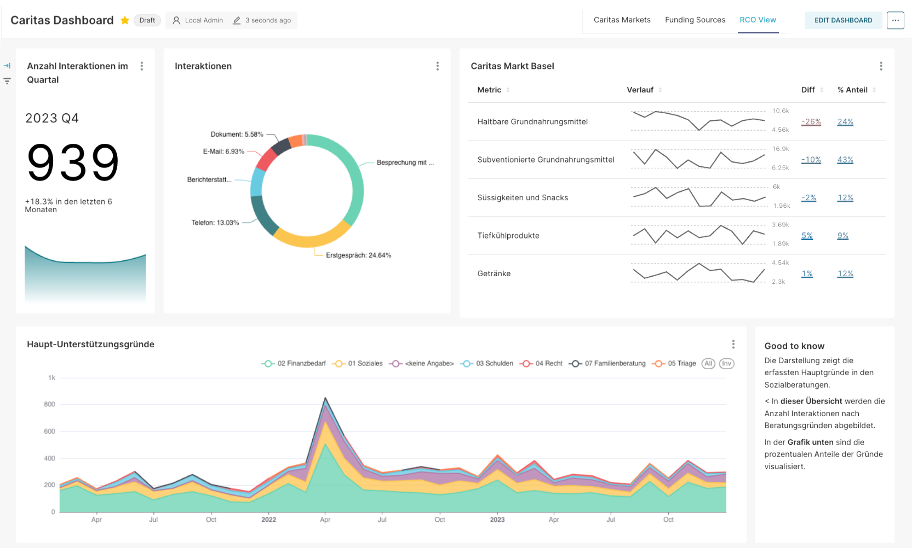

# Data Dashboard for NGOs

**An open-source, local-first dashboard that helps civil society organisations (CSOs) turn the data they already record during their work into evidence – for their own practice, their strategy and social policy advocacy.**

The dashboard is built on [Apache Superset](https://superset.apache.org/) and [PostgreSQL](https://www.postgresql.org/) and runs in containers on an ordinary laptop. **It is built for local use:** no cloud, no hosted server and no internet connection needed once it is installed. Client data stay on the organisation's own computer unless someone chooses to export or share them. The supplied demo data follow this [data standard for social counselling from Caritas](https://doi.org/10.5281/zenodo.22919492), an openly licensed minimum set of eleven characteristics. They are fully synthetic, so anyone can try the app without touching a real case.



*The dashboard prototype. The local app currently lets you import data and build your own charts.*

It grew out of a research cooperation between the [Bern University of Applied Sciences (BFH)](https://www.bfh.ch/soziale-arbeit/) and Caritas Switzerland within the SNSF National Research Programme "Covid-19 in Society" (NRP 80), the research project “[Civil Society Organisations as Agents of Innovation](https://www.bfh.ch/en/research/research-projects/2026-416-220-497/)”, and the Innosuisse – Swiss Innovation Agency Project "[Datennutzung Caritas](https://doi.org/10.24451/dspace/11848)". It is designed so it can be used by any CSO - free of charge and open source.

> **Status:** this is an early version of the data dashboard. A full release with pre-configured statistics charts will follow up as soon as we find the time for it. Please also see the [Limitations](#limitations).

---

## Contents

- [Why this dashboard exists](#why-this-dashboard-exists)
- [Why open source](#why-open-source)
- [What it shows](#what-it-shows)
- [How it works](#how-it-works)
- [Local only, by design](#local-only-by-design)
- [Data protection by design](#data-protection-by-design)
- [Getting started](#getting-started)
- [Demo data](#demo-data)
- [Limitations](#limitations)
- [Background and proof of concept](#background-and-proof-of-concept)
- [How to cite](#how-to-cite)
- [Credits, funding and licence](#credits-funding-and-licence)
- [References](#references)

---

## Why this dashboard exists

### From individual cases to structural patterns

CSO social workers often start with many individual interactions, and from them gather valuable insights into social problems. For such evidence to enter societal negotiation at the macro level, it has to pass through a process: cases are aggregated, contextualised, contrasted, examined for patterns and translated into ideas that policy actors can take up.

This path connects different realities: those of the people seeking support, of departments within the organisation, and of external stakeholders. It requires cooperation inside the organisation, to make sense of experiential knowledge, and outside it, to translate findings into policy. It requires organisational commitment across departments, and **a technical implementation that meets data ethics.** This repository is one building block of that technical side.


### What CSO data add to official statistics

governmental instruments to measure poverty are known to leave gaps:

- **Delay.** Official poverty statistics appear with a delay of up to multiple years.
- **Reach.** Surveys and registers reach people in hidden poverty only partially, especially those who avoid public authorities.
- **Breadth.** Income-based measures capture the level of resources, but say little about the problems behind a situation of poverty.

Organisational data from CSOs can complement this picture along the same three lines (Sutter & Hümbelin 2026a; 2026b):

|                | What CSO counselling data add                                                                                                         |
| -------------- | ------------------------------------------------------------------------------------------------------------------------------------- |
| **Timeliness** | Data with a granularity of 1 to 30 days, compared with official statistics published years later.                                     |
| **Proximity**  | Insight into groups that official statistics capture poorly, such as people who do not claim benefits they are entitled to.           |
| **Breadth**    | The recorded reasons for support cover several dimensions of lived poverty at once – debt next to housing, health or legal questions. |

In short: where state poverty monitoring ends, the knowledge of civil society begins.

### What this path can achieve – and where it stops

The research behind this project documents how counselling data have already informed social policy.

- **COVID-19.** During the pandemic, rising case numbers documented the hardship of low-income households. They backed the call for full short-time work compensation for low earners, adopted at the end of 2020.

- **Policy evaluations** After policy reforms that affect the addressees of CSOs, patterns in their organisational data can inform the evaluation of the policy (see Sutter 2026a).

In this sense, the CSO acts as an **early detector of social problems**.

The same research also shows the **limits of this path, at both of its ends**:

- **At the micro level**, re-using operational client data can play into the *trust–exposure paradox* (Sutter et al. 2026). People turn to a CSO because they trust it; anything that exposes them can deter those most in need. This is why data protection is not an add-on here but the design principle.

- **At the macro level**, being heard does not mean being heeded. In the consultation on the migration-law issue above, 43 of 44 specialised CSOs supported a reform, but the responsible commission concluded that no change was needed (Sutter 2026b). Receptive policy spaces cannot be taken for granted.

A dashboard cannot solve the second problem. What it can do is make sure that, when a policy window opens, CSOs have timely, sound and ethically produced evidence at hand. Understood this way, CSO data systems are part of a *democratic infrastructure*: the article that develops this argument (Sutter & Hümbelin 2026a) appeared in a special issue of *European Social Work Research* on embracing democracy in social work practice and research (Auner, Spensberger & Uggerhøj 2026).

## Why open source

Large organisations can sometimes afford tailor-made analytics; small and regional CSOs rarely can, although their view of local problems is especially specific and immanent. Most case-management software in the sector is commercial and proprietary, and practitioners across all organisational levels report their shortcomings (Sutter & Hümbelin 2026a). The result is data silos, and every organisation pays for the same gaps again.

If small and regional organisations are to be part of such early-detection systems, **shared digital commons are the alternative to isolated proprietary products** (Sutter & Hümbelin 2026a; Warso & Krewer 2024). Publishing this dashboard as open source is a direct consequence of the project's findings:

- **Lower barriers.** Any CSO can use, adapt and extend it free of charge.
- **Digital sovereignty.** No vendor lock-in; the organisation keeps full control over its data and its tools.
- **Protected discretion.** Modular, open software can be shaped around professional practice instead of the other way round.
- **Comparability.** A shared data standard plus a shared tool make figures comparable across offices and organisations, without pooling raw data.
- **Joint development instead of duplication.** Improvements made by one organisation benefit all.

## What it shows

The indicators follow the project's recommendation to agree on a small set of meaningful indicators rather than measuring everything (Sutter & Hümbelin 2026a; 2026b). The prototype and the planned charts address three guiding questions: *Why do people come? Where does need accumulate? How long do they need support?* In this version, you create the charts yourself in Superset; the table below describes the intended views.

| View                    | Indicators (examples)                                                                                                                               |
| ----------------------- | --------------------------------------------------------------------------------------------------------------------------------------------------- |
| **Activity**            | counselling events over time; new registrations with change on the previous year; event types (Erstgespräch, meetings, phone, e-mail …); time spent |
| **Reasons for support** | frequency and combinations of the standard's reasons, over time and by office                                                                       |
| **Client profiles**     | age groups, household type, children, employment situation                                                                                          |
| **Regions**             | distribution by office and canton (map)                                                                                                             |
| **Data quality**        | share of missing values per characteristic, harmonisation from office categories to the standard                                                    |

Charts can be filtered interactively (by period, office, status, reason …). This lets practitioners explore their own data without programming skills. Further indicators are documented as development options in the prototype report (Sutter, Glaus & Hümbelin 2025): case trajectories, length of support, waiting times, and contextual data such as unemployment and inflation.

## How it works

The app has two browser interfaces. The **data importer** lets you upload a CSV or Excel file, review the column types and conversions, and fix errors before loading it. **Superset** connects to the PostgreSQL database so you can explore the imported tables and build charts and dashboards.

The `run.sh` script runs these services locally with Podman. Original cell values are kept alongside the typed tables used for analysis. The supplied demo includes English and German labels, a codebook, and optional SQL views for counting events, clients, and reasons for support.

For the technical details, see [the architecture guide](docs/architecture.md). The [demo-data guide](docs/demo-data.md) explains how to load the supplied files and use their SQL views. Category mapping for your own data needs to be prepared separately; the importer does not enforce the Caritas standard automatically.

## Local only, by design

The dashboard is deliberately **not** a public web service. Everything runs on one computer:

- **Local ports only.** PostgreSQL, Superset, and the importer listen only on `127.0.0.1`. Their ports are not exposed to the local network or the internet.
- **No remote access.** The web apps have local addresses, with no public URL or hosted server to secure.
- **No cloud.** Data are stored, processed and visualised on the machine on which they are loaded.
- **Offline.** An internet connection is needed only to download the software. After that, the dashboard works without one.

**Why local?**
- **It removes a whole class of risks.** The first prototype ran on a university server reachable over the internet, with a reverse proxy, password protection and no encrypted connection. The project report lists firewalls, certificates, identity management and hardening as preconditions for running such a system safely (Sutter, Glaus & Hümbelin 2025). A local setup avoids all of them.
- **It suits small organisations.** A regional office without an IT department can run the dashboard on a laptop without operating or securing a server.
- **It makes data protection credible.** Social workers and clients can be told plainly that counselling data never leave the organisation's computer.

Sharing results remains a conscious, manual step, for example exporting a chart for a report after checking it for small groups.

## Data protection by design

Counselling data include *particularly sensitive personal data* in the sense of Swiss data protection law: health and social assistance measures, often combined with residence status. The project recommends the following safeguards (Sutter, Glaus & Hümbelin 2025; Sutter & Hümbelin 2026a). They describe how an organisation should prepare and use its data; the importer does not automatically anonymise records, remove unnecessary columns, or suppress small groups.

1. **Earliest possible anonymisation.** Data leave the case-management software without direct identifiers. Anonymised export options were developed and tested with practice partners.
2. **Data minimisation.** Only the characteristics needed for the agreed indicators are loaded. The data standard is deliberately a minimum set.
3. **Local only.** No hosted server or cloud; the apps' ports are bound to `localhost` only (see [Local only, by design](#local-only-by-design)).
4. **Roles and rights.** Decide who sees which views; aggregated views for policy work, detailed views only where needed.
5. **Small numbers.** Before charts leave the organisation, check for small groups and merge or suppress them.
6. **No real data in this repository.** Not even as the basis for synthesis – see [Demo data](#demo-data).

## Getting started

You need Podman, a browser, and a Bash terminal. Open the terminal in this project folder. On macOS, start your Podman machine first:

```sh
podman machine start
```

If you have not created a machine yet, run `podman machine init` once before starting it. Then start the app:

```sh
./run.sh start
```

The first start downloads and sets up the software. Open these addresses after it finishes:

| App | Default address | What you do there |
| --- | --- | --- |
| Data importer | [http://127.0.0.1:8090](http://127.0.0.1:8090) | Upload a file, review types and validation, and import it. |
| Superset | [http://127.0.0.1:8088](http://127.0.0.1:8088) | Explore datasets and create charts and dashboards. |

The default Superset login is `admin` / `admin`, unless you chose different details during setup. PostgreSQL's default database connection is `127.0.0.1:5432`, database `caritas`; it is not a browser page. If a default port was busy, the runner chooses another. Run `./run.sh status` to see the actual addresses and ports for your installation.

To try the app, upload either language version of the [demo data](#demo-data) through the importer. The files and optional SQL views are not loaded automatically. You then add a dataset from **Caritas Local PostgreSQL** in Superset and create your charts.

The detailed instructions live in `docs/`:

- [Install, import data, and make your first chart](docs/getting-started.md)
- [Load the demo data and use its analysis views](docs/demo-data.md)
- [Back up your work or start from a portable backup](docs/backup-restore.md)
- [Connect Power BI and understand what can be transferred](docs/power-bi.md)
- [Understand the app's architecture and technical limits](docs/architecture.md)

To stop the app while keeping your work, run `./run.sh stop`.

**Using your own data:** export anonymised data from your case-management software and prepare the category mapping using [`data/codebook.csv`](data/codebook.csv). Use a different filename from the demo files so your imported tables stay separate. Keep real data out of version control. The [import guide](docs/getting-started.md#import-your-data) explains where original and converted values are stored and how replacing or appending affects existing data.

### Repository structure

```text
├── README.md              project introduction, background, and references
├── run.sh                 start, stop, status, backup, and restore commands
├── data/                  English and German demo CSVs, codebook, and description
├── docs/                  setup, technical guides, simulation rationale, and bibliography
│   └── images/            dashboard prototype image shown above
├── scripts/               data importer and synthetic-data generators
├── sql/                   optional English and German demo tables and analysis views
├── superset/              local Superset configuration
└── tests/                 importer and backup/restore checks
```

## Demo data

The repository contains **fully synthetic data** for a fictional organisation, the *Sample CSO/NGO*, with five offices: `data/en/counselling_events.csv`.

- It holds about 15,000 counselling events of about 5,500 clients, 2022–2025, one row per event.
- Each row carries the client's characteristics of the data standard, including the reasons for support.

The same records with the German labels of the data standard are in `data/de/beratungsdaten_synthesized.csv`. See [`data/README.md`](data/README.md) for all files and columns.

They follow the data standard, are internally consistent, contain realistic gaps, and are fully reproducible from the scripts. They were generated by a rule-based simulation with hand-set parameters. **No real client record from any organisation was used**, neither directly nor as input for a statistical synthesis model.

[`docs/synthetic-data.md`](docs/synthetic-data.md) explains every modelling decision and why we chose not to synthesise from real data. It also explains when a tool such as synthpop can be a good option for organisations that want a synthetic copy of their own data.

> Figures computed from the demo data are invented.

## Limitations

- **Prototype.** Role-based access, encryption at rest, audit logging and automated backups are not yet configured out of the box. Their importance is documented in Sutter, Glaus & Hümbelin (2025).
- **Single machine.** The setup is designed for one organisation on one computer, not for a shared multi-organisation platform. However, any organisation could transfer the project to an own server or to [preset.io](https://preset.io/).
- **Data quality first.** The dashboard can only show what is recorded consistently. Harmonising data entry along the standard is the precondition for meaningful comparisons.
- **No substitute for participation.** Statistical evidence complements but does not replace the knowledge of people affected by poverty. Involving service users in shaping indicators and interpretations remains an open task (Sutter & Hümbelin 2026a).

## Background and proof of concept

The dashboard rests on three successful projects:

- **SNSF NRP 80 project "Poverty and Social Security in Times of Crisis"** (PI: Oliver Hümbelin, Grant No. 210054).
  - NGOs supported around 400,000 people in Switzerland, while the official poverty statistics lag by up to three years and are not broken down regionally.
  - Between 2023 and 2026, the project tested and confirmed the feasibility of a social early-warning system based on organisational data of NGOs (Sutter & Hümbelin 2026a).
  - A first national data standard for social counselling was published (Caritas Schweiz & Sutter 2026).
- **Innosuisse preliminary project at BFH** (PI: Rulla Sutter). A dashboard prototype was developed with an Innosuisse innovation cheque and at Hack4SocialGood 2024 (Sutter et al. 2024). It was refined in a design sprint and documented open access (Sutter, Glaus & Hümbelin 2025).
- **Recommendations for practice.** Nine recommendations on the social-policy use of NGO data were published for practitioners (Sutter & Hümbelin 2026b). This repository implements several of them directly:
  - a common data standard
  - privacy from the start
  - flexible, modular software
  - shared open-source solutions

| Year | Milestone |
|---|---|
| 2024 | Hack4SocialGood challenge and first prototype |
| 2025 | Prototype documentation published; design sprint |
| 2026 | Data standard adopted and published on Zenodo; peer-reviewed article and practitioner handout |
| 2027 | Planned open-source release of the dashboard (this repository) |

## How to cite

If you use this software, please cite this repository and the data standard:

> Caritas Schweiz & Sutter, R. (2026). *Datenstandard Sozialberatung im Caritas-Netz Schweiz* (Version 1.0). Zenodo. https://doi.org/10.5281/zenodo.22919492

For the conceptual background, please cite Sutter & Hümbelin (2026a).

## Credits, funding and licence

**Development:** Rulla Sutter (BFH, Institute for Social Security and Social Policy), with Kian Sahafi (development, 2026), Jeremy Glaus (prototype, 2024–2025), and Oliver Hümbelin (PI).

**Practice partners:** we thank Caritas Switzerland, Caritas beider Basel and the Caritas markets for their trust, their data-protection-conscious cooperation and their commitment to fighting poverty. We also thank the whole Hack4SocialGood team.

**Funding:** Swiss National Science Foundation, National Research Programme ["Covid-19 in Society" (NRP 80)](https://www.nfp80.ch/en), project "[Poverty and Social Security in Times of Crisis](https://www.nfp80.ch/en/fhRyLtkBS8JWMatg/project/poverty-and-social-security-during-the-covid-19-pandemic)" (Grant No. 210054); research project “[Civil Society Organisations as Agents of Innovation](https://www.bfh.ch/en/research/research-projects/2026-416-220-497/)” and Innosuisse innovation cheque.

**Licence:** code under the [Apache License 2.0](https://www.apache.org/licenses/LICENSE-2.0) (the licence of Apache Superset); synthetic data and documentation under [CC BY 4.0](https://creativecommons.org/licenses/by/4.0/).

**Contact:** Rulla Sutter, Bern University of Applied Sciences – rullasutter@proton.me

## References

Auner, C., Spensberger, F., & Uggerhøj, L. (2026). Embracing democracy in social work practice and research [Editorial]. *European Social Work Research, 4*(2), 145–150. https://doi.org/10.1332/27551768Y2026D000000085

Caritas Schweiz & Sutter, R. (2026). *Datenstandard Sozialberatung im Caritas-Netz Schweiz* (Version 1.0) [Data set]. Zenodo. https://doi.org/10.5281/zenodo.22919492

Sutter, R. (2026a). *How civil society organisations mediate social rights after welfare chauvinist reforms: A Swiss case study* (University of Bern Social Sciences Working Papers No. 60). https://ideas.repec.org/p/bss/wpaper/60.html

Sutter, R. (2026b, February 25). Between support and fear: Civil society at the margins of social assistance. *nccr – on the move blog*. https://nccr-onthemove.ch/blog/between-support-and-fear-civil-society-at-the-margins-of-social-assistance/

Sutter, R., Eggenschwiler, Y., Hümbelin, O., Masé, A., & Mahmoud, I. (2024). *Von Daten zu Taten: Ein Datentool für die Caritas Schweiz* [Poster]. Hack4SocialGood 2024. https://doi.org/10.24451/arbor.21797

Sutter, R., Glaus, J., & Hümbelin, O. (2025). *Caritas Dashboard: Prototype insights, Dokumentation und Reporting*. Berner Fachhochschule, Soziale Arbeit. https://doi.org/10.24451/dspace/11848

Sutter, R., & Hümbelin, O. (2026a). Evidence-based policy engagement of social welfare non-governmental organisations: A case study on the democratic relevance of Caritas Switzerland's data ecosystem. *European Social Work Research, 4*(2), 233–253. https://doi.org/10.1332/27551768Y2026D000000079 (freely accessible working paper version: https://ideas.repec.org/p/bss/wpaper/61.html)

Sutter, R., & Hümbelin, O. (2026b). *Handout für Fachpersonen: Sozialpolitische Relevanz von NGO-Daten*. Berner Fachhochschule, Soziale Arbeit. https://doi.org/10.24451/arbor.14363

Sutter, R., Mittmasser, C., Schambron, L., Friedli, A., Müller-Suleymanova, D., Froehlich, N., Gauttier, E., Carbajal, M., Rosenstein, E., & Drilling, M. (2026). *Unpacking paradoxes in times of crisis: How civil society organizations shape processes of vulnerabilization* (University of Bern Social Sciences Working Papers No. 58). https://repec.sowi.unibe.ch/files/wp58/Sutter-etal-2026-unpacking-paradoxes.pdf

Warso, Z., & Krewer, J. (2024). *Digital commons as providers of public digital infrastructures*. Open Future. https://openfuture.eu/wp-content/uploads/2024/11/241113_Digital-Commons-as-Providers-of-Public-Digital-Infrastructures.pdf

BibTeX for all entries: [`docs/references.bib`](docs/references.bib).
