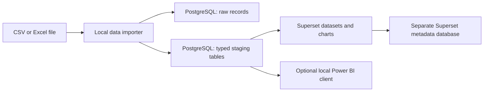

# How the local app works

[Back to the project introduction](../README.md)

This guide describes the code in this repository. For installation and everyday use, start with [the setup guide](getting-started.md). The research background and the intended indicators are described in the [project introduction](../README.md).

## Services and connections

[`run.sh`](../run.sh) starts three containers on the Podman network `caritas_local`:

| Service | Default container | Purpose | Default host address |
| --- | --- | --- | --- |
| Data importer | `caritas_import_ui` | Flask interface for reviewing and importing CSV, XLS, and XLSX files | `http://127.0.0.1:8090` |
| Apache Superset | `caritas_superset` | Datasets, SQL queries, charts, and dashboards | `http://127.0.0.1:8088` |
| PostgreSQL | `caritas_postgres` | Imported rows, typed tables, and reporting views | `127.0.0.1:5432` |

PostgreSQL is a database connection rather than a browser page. The runner can choose different host ports if the defaults are occupied; `./run.sh status` reports the local addresses. Containers connect to PostgreSQL on its internal port `5432`, regardless of the selected host port.

The runner uses Podman commands directly. There is no Compose configuration or Docker runner in this repository. The container definitions use PostgreSQL `16.4-alpine`, Apache Superset `4.1.1`, and Python `3.12.5` for the importer. The importer image installs Flask, pandas, openpyxl, xlrd, and psycopg2; see the two [container definitions](../Containerfile.ingest) and [Superset image definition](../Containerfile.superset).

On first start, the runner creates the network and data volumes, builds missing helper images, creates the PostgreSQL schemas, runs Superset metadata migrations, and registers the database as **Caritas Local PostgreSQL**. It creates a default Superset administrator for a new installation. Restored installations keep the accounts from their backup.

## Import and storage

[`scripts/import_ui.py`](../scripts/import_ui.py) provides the upload and review screens. [`scripts/import_staging.py`](../scripts/import_staging.py) reads files and performs the conversions used by both the web interface and terminal imports.

The web importer checks all cells when a file is uploaded and when conversion choices change. It shows valid, empty, and invalid counts per column, with a limited set of examples. The server repeats validation before writing. The selected type determines the available transforms: text cleanup, numeric parsing, or date parsing. These checks validate conversion to a database type; they do not check every meaning or category prescribed by the counselling data standard.

Successful imports write to:

| Location | Contents |
| --- | --- |
| `raw.import_batches` | File and sheet names, original column names, row count, target table, and import timestamp |
| `raw.import_rows` | Cell values read from the source, stored as JSON with batch and source-row information |
| `staging.<table_name>` | Converted columns plus import metadata |
| `analytics.import_batches` | A view of the batch history |

The JSON preserves the values read by pandas, not the original workbook's formatting or a copy of the file. Postal-code columns are kept as text by automatic type detection. The importer supports `text`, `integer`, `bigint`, `numeric`, `date`, and `timestamp` columns.

Web imports replace existing tables by default. Replacement removes their earlier raw import records and drops dependent PostgreSQL views. Append mode adds a batch and requires selected types to match existing columns. Terminal imports append. Both paths use a database transaction across the workbook, so a failed import rolls back its database changes. Details and examples are in [the import guide](getting-started.md#import-your-data).

PostgreSQL data live in the `caritas_postgres_data` volume. Superset uses a separate `caritas_superset_home` volume; its default metadata database is SQLite at `/app/superset_home/superset.db`. That metadata holds users, database connections, dataset definitions, charts, and dashboard layouts. Saving a Superset virtual dataset does not create a PostgreSQL view.

## Optional demo schemas

The supplied [English SQL](../sql/schema_en.sql) creates `demo_en.counselling_events`; the [German SQL](../sql/schema_de.sql) creates `demo_de.beratungsdaten`. Each schema has one event table, with the client characteristics repeated on each event. Its views provide:

- events with derived year, month, age at the event, and an ISO canton label;
- one row per client, with age groups, event counts, minutes, and first and last service dates;
- one row per client and named reason for support.

These are optional demo schemas. `run.sh start` does not execute the SQL or load the CSV files. Importing a demo CSV through the normal importer creates a `staging` table and does not create the `demo_en` or `demo_de` views. Running either schema file recreates its base demo table and removes dependent views before creating the supplied views again.

See [the data description](../data/README.md) for the bilingual files and codebook, and [the simulation notes](synthetic-data.md) for how the records were generated. The labels and mappings already present in these demo files come from the generator. The generic importer does not automatically translate, harmonise, or validate an organisation's categories against the data standard. The SQL views prefix the existing canton code with `CH-`; they do not look up cantons from newly imported postcodes.

Charts and dashboards are created in Superset after loading data. The repository does not automatically install a chart export, map geometry, or an offline basemap. The prototype image illustrates earlier work rather than a dashboard created on first start. For reporting examples, see [case and service analysis](analytics-example.md); for a second reporting tool, see [Power BI](power-bi.md).

## Local access and data protection

All three host ports bind to `127.0.0.1`. This makes the services accessible from the same computer rather than publishing them to the local network. The app still runs local HTTP and database servers. Superset has a login; the importer has no separate authentication.

The current implementation has these limits:

| Area | Current behavior |
| --- | --- |
| Source preparation | The importer accepts the columns supplied to it. Removing direct identifiers and selecting the required characteristics are tasks for the person preparing the export. |
| Anonymisation | No automatic anonymisation, pseudonymisation, k-anonymity, or disclosure-risk check runs during import. |
| Aggregation | Analysts choose the queries, charts, and filters. Small groups are not automatically suppressed or merged. |
| Access rights | Superset permissions can be configured, but the runner does not set up a project-specific separation between access to raw rows and access to aggregates. |
| Encryption | The default local services use HTTP and an unencrypted PostgreSQL connection. The runner does not configure disk or backup encryption. |
| Retention | Raw values remain in PostgreSQL until removed. Uploaded files remain in the importer's temporary directory; files older than 24 hours are cleaned up when another upload triggers cleanup. |
| Backups | Backups are manual. They include the imported data, credentials, and Superset encryption key. |

The preparation, access decisions, and checks before sharing described in the research documentation are an operational workflow for the organisation. Import validation alone does not perform those steps.

## Backup and recovery

`./run.sh backup` creates a portable folder containing the app source, configuration, database dump, Superset home, container images, saved settings, and checksums. It also copies the supplied public demo CSVs, their description and codebook, and the two optional SQL schemas when present. It does not copy other files from `data/` or `sql/`. The importer and Superset stop briefly while the data snapshots are taken, then restart if they were running.

On a clean destination with Podman ready and the same CPU architecture, run `./run.sh restore` from the copied backup folder. The restored folder becomes the working app directory. Restore refuses existing target containers or data volumes. Original Excel files, local Power BI report files, and manually managed PostgreSQL reader accounts are separate from the package. See [backup and restore](backup-restore.md) for the full procedure.
